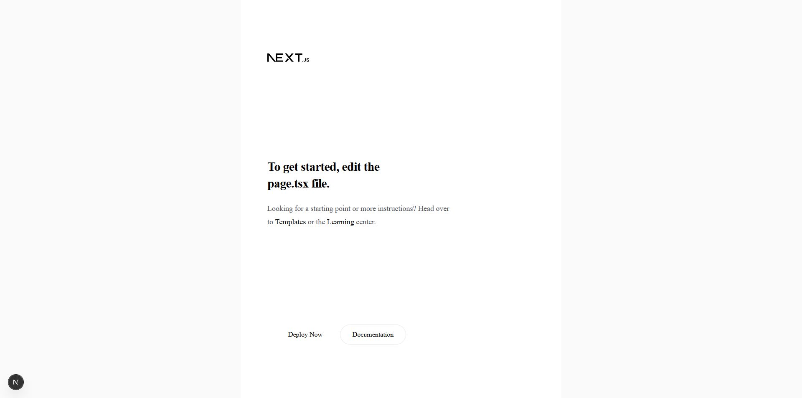
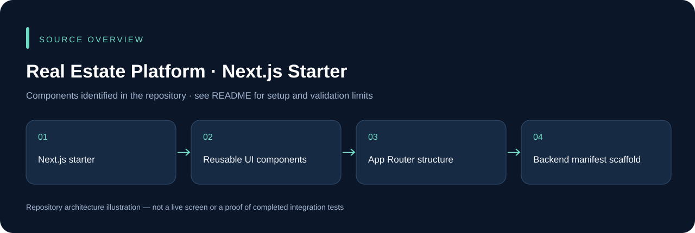

# Real Estate Platform · Next.js Starter

A Next.js/TypeScript project starter intended for a real-estate interface. It contains reusable UI/property components, but the current home page is still the default Next.js startup page. The backend currently contains a dependency manifest rather than a complete service implementation.

## Run the current frontend

```powershell
cd frontend
npm ci
npm run dev
```

Open the URL printed by Next.js. `npm run build` creates a production frontend build; `npm start` serves an existing build. Respect `frontend/AGENTS.md` when developing against this project's Next.js version.

## Current scope

The source is a starting point, not a finished property marketplace. Property persistence, authentication, listing search and production backend behavior are not established by this repository. The screenshot below intentionally shows the current startup screen rather than an invented completed product.

## Application preview



Captured from the current repository running locally. The default Next.js starter is still present; this is not a completed property-listing screen.

## Source overview



This diagram is derived from the repository structure; it is not an application screenshot.

## Development and validation

Use an isolated development database and synthetic records. Keep credentials, device sessions, signing keys and operational uploads outside Git. The presence of source code does not establish that every integration or deployment scenario has been tested. See [repository review](docs/REPOSITORY_REVIEW.md) for this audit's scope.

## Ownership and contributions

Existing author, template, asset and dependency attributions remain in place. Follow any existing license files; this documentation update does not grant a new license. For a change, describe the affected workflow, configuration and checks so it can be reviewed without guessing.
