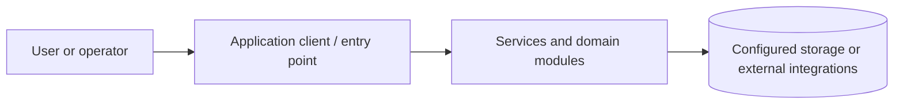
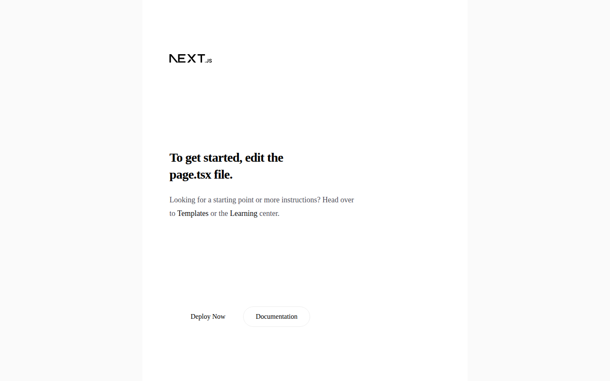
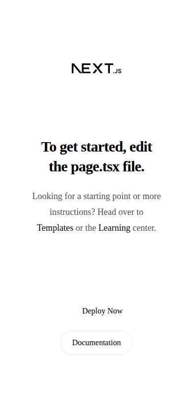

# Real Estate Listings Platform | Next.js, TypeScript, Express

Real estate web application built with Next.js App Router, TypeScript and Tailwind CSS, with a separate Express/Mongoose backend.

**Explore this repository:** [Architecture](docs/ARCHITECTURE.md) · [Developer runbook](docs/RUNBOOK.md) · [Screenshot evidence guide](docs/SCREENSHOT_GUIDE.md) · [Audit](docs/PORTFOLIO_AUDIT.md)

**Discoverability topics:** `real-estate` · `property-listings` · `nextjs` · `typescript` · `tailwindcss` · `express` · `mongodb`. These are suggested GitHub repository topics, not a claim that the repository settings have been updated.

> **Status:** Source-reviewed documentation draft. Frontend build, HTTP startup and automated browser screenshot capture **have passed in GitHub Actions**; end-to-end property workflows and backend remain unverified. Review PR before merging.

A property platform under development with Next.js frontend and Express/Mongoose backend. The frontend contains a property-card component and reusable UI elements.

## Repository map

- `frontend/` — Next.js App Router interface.
- `backend/` — Express/Mongoose service.

## Technology

Next.js, React, TypeScript, Tailwind CSS, Express, MongoDB/Mongoose.

## Getting started

### Prerequisites

Install the runtime and tools relevant to this project (Node.js/npm, Python, .NET SDK, mobile SDK, or desktop runtime). Use the package manifest and lockfile to determine exact compatible versions. Obtain required databases and API credentials from your own provider accounts; never commit secrets.

### Install and run

**Frontend:** `cd frontend && npm ci && npm run dev`.

**Backend:** `cd backend && npm ci`; there is no backend `start` script in the inspected package manifest, so identify the entry point and configuration before running it.

> These commands are derived from repository manifests, not confirmed by an end-to-end launch. If startup fails, inspect the relevant service's environment variables, dependency versions and logs.

## Architecture and data flow

This is a **conceptual overview**, not a verified deployment topology. The directory map above identifies the actual code areas to inspect for detailed component boundaries.

## Validation and troubleshooting

1. Confirm compatible runtime versions and install dependencies using the checked-in lockfiles.
2. Supply local environment variables through ignored files or a secrets manager.
3. Start required database, queue, mobile emulator or API dependencies.
4. Run scripts declared in the package manifests; record exit codes and failing commands.
5. Verify a complete user workflow with **non-sensitive demo data**.
6. Capture screenshots only after successfully launching the real application.

If you see a connection error, verify service endpoints and credentials without printing secrets. If a native build fails, verify platform SDK versions and native dependencies. Never treat a successful dependency installation as proof that the app works.

## Screenshots

The [GitHub Actions browser verification](https://github.com/asimasgharali243/real-estate-platformNaveed/actions/workflows/portfolio-ui-verification.yml) has successfully built and started the frontend and captured real Chromium screenshots. The workflow is configured to commit captures to the review branch. Images below render once those files have been committed.

## Security and maintenance notes

The backend's `npm test` is a placeholder that intentionally exits with an error; do not report tests as passing.

Review dependency advisories, license terms, authorization boundaries, sensitive files and third-party integrations before public deployment.

## Contributing

Open an issue with a reproducible description. Work on a feature branch, keep changes focused, update tests and docs, and request review through a pull request. Do not include credentials, customer data or personal information in issues or screenshots.

## Documentation status

- [x] Purpose and source-derived architecture overview
- [x] Repository map and initial run instructions
- [x] Security and operational caveats
- [ ] Clean-environment startup verified
- [ ] End-to-end workflow tested
- [x] Real browser screenshots captured by CI (visual review and repository commit pending)
- [ ] Production readiness assessed

For the detailed verification checklist see [docs/PORTFOLIO_AUDIT.md](docs/PORTFOLIO_AUDIT.md).
